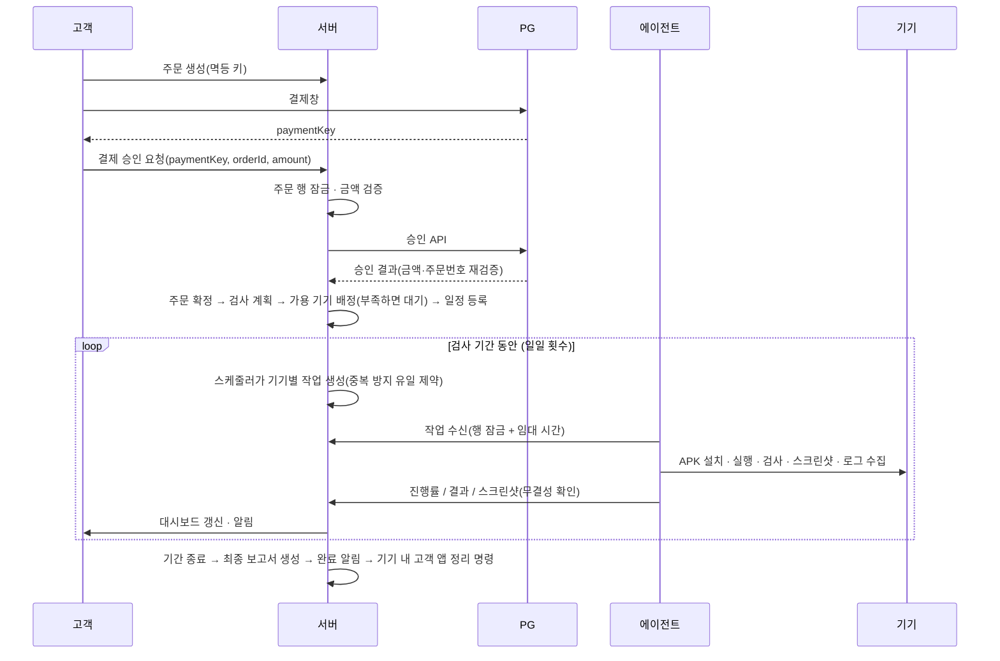

# 시스템 구성도

```mermaid
flowchart LR
  subgraph Cloud["Railway (google-auto-tester)"]
    WEB["web 서비스<br/>FastAPI + React 화면<br/>스케줄러(APScheduler)"]
    DB[("PostgreSQL<br/>업무 데이터 + 작업 큐")]
    VOL[("볼륨 /data<br/>APK·스크린샷·보고서·백업")]
    WEB --- DB
    WEB --- VOL
  end
  C["고객 브라우저<br/>홈페이지·대시보드"] -->|HTTPS| WEB
  A["관리자 브라우저<br/>/admin"] -->|HTTPS| WEB
  PG["PG사(토스페이먼츠)"] <-->|승인·취소 API / 웹훅| WEB
  subgraph Site["검사 전용 네트워크 (운영자 사업장)"]
    AG["제어 PC<br/>Google Auto Tester Agent"]
    FARM["Phone Farm Box<br/>Android 기기 20대+"]
    AG -->|표준 ADB (USB/LAN)| FARM
  end
  AG -->|HTTPS 폴링 + 인증된 WebSocket<br/>(밖으로 나가는 연결만)| WEB
```

- ADB 포트는 인터넷에 노출하지 않습니다. 에이전트가 서버로 **나가는 연결만** 맺습니다.
- 제어 PC·장비 박스를 늘리면 에이전트를 추가 등록하는 방식으로 20대 → 1,000대 이상까지 중앙 서버 하나에서 관리합니다.

## 결제 후 자동 처리 흐름



## 주요 설계

| 주제 | 구현 |
| --- | --- |
| 작업 큐 | `test_jobs` 테이블. 수신 시 `FOR UPDATE SKIP LOCKED`, 임대 토큰·만료 시각, 기기당 실행 중 작업 1개 부분 유일 인덱스 |
| 중복 방지 | 작업 `(plan, device, run_key)` 유일, 결제 `주문당 결제 완료 1건` 부분 유일 인덱스, 웹훅 `(provider, event_id)` 유일, 주문·환불 멱등 키 |
| 재시도 | 실패·타임아웃 시 지수 백오프(60초 × 2ⁿ), 최대 횟수 초과 시 '수행 불가' 결과로 기록(성공으로 기록하지 않음) |
| 장애 복구 | 모든 상태가 DB에 있어 서버 재시작 후 그대로 이어짐. 에이전트는 결과를 디스크에 먼저 보관하고 전송, 연결 복구 후 동기화 |
| 대체 기기 | 배정 기기가 기준 시간(기본 30분) 이상 오프라인이면 다른 가용 기기로 교체 |
| 모의/실제 분리 | 모의 결제 주문 ↔ 모의 에이전트 기기만 배정. 결과·스크린샷·보고서·매출에 `is_mock` 표시, 실매출 집계에서 제외 |
| 권한 | 고객 데이터는 모든 조회에서 `customer_id`로 격리. 관리자는 역할별 메뉴 권한. 에이전트는 별도 인증키 |
| 비밀값 | PG·SMTP·AI·OAuth 키와 고객 테스트 로그인 정보는 Fernet 암호화 저장, 화면에 다시 표시하지 않음 |

## 데이터베이스

45개 테이블(`backend/app/models.py`, 마이그레이션 `backend/alembic/versions/0001_initial_schema.py`).
요구 테이블 36종(users, roles, permissions, customers, sessions, apps, app_versions, app_files, products, orders, payments, payment_events, refunds, coupons, agents, agent_tokens, devices, device_groups, device_heartbeats, test_plans, test_scenarios, test_schedules, test_jobs, test_results, device_assignments, screenshots, crash_logs, performance_metrics, reports, notifications, notification_templates, support_tickets, announcements, system_settings, audit_logs, backup_history)에 더해 role_permissions, login_history, user_tokens, device_commands, ticket_messages, faqs, legal_docs, tester_invites, system_logs를 둡니다.
